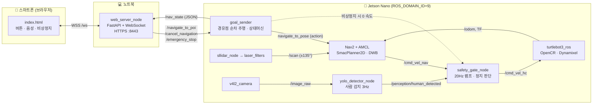

# 🦽 병원 실내용 모듈형 자율주행 휠체어 (졸업작품)

> **노약자를 위한 음성인식 자율주행 휠체어 모듈**
> Voice-Enabled Autonomous Wheelchair Module for Elderly Users
>
> 충북대학교 지능로봇공학과 캡스톤디자인 Ⅰ·Ⅱ · 2025.09 ~ 2026.06 · 2인 팀 (이승준, 장동완)

기존 수동 휠체어 하단에 붙였다 뗄 수 있는 **자율주행 구동 모듈**을 목표로, 3D 프린터로 만든 축소 플랫폼 위에 ROS 2 자율주행 시스템을 구현했습니다.
사용자가 스마트폰 웹 페이지에서 **버튼이나 음성으로 병실을 고르면**, 휠체어가 지도 위에서 경로를 계획하고 복도 중앙 경유점을 거쳐 병실 문 앞에서 방향을 맞춘 뒤 진입합니다.

| 항목 | 내용 |
|---|---|
| 내 역할 | **팀장** · 하드웨어 설계 · 모터 제어 · 안전 알고리즘 설계 |
| 플랫폼 | ROS 2 Humble · Ubuntu 22.04 · Python 3.10 |
| 하드웨어 | NVIDIA Jetson Nano · OpenCR 1.0 + Dynamixel (차동 구동) · RPLIDAR 2D 라이다 · USB 카메라 · 12V Li-Po |
| 핵심 기술 | Nav2 (SmacPlanner2D + DWB) · AMCL · SLAM · YOLO(ultralytics) · FastAPI/WebSocket · Web Speech API |

---

## 목차
1. [왜 만들었나](#1-왜-만들었나)
2. [주요 기능](#2-주요-기능)
3. [시스템 구조](#3-시스템-구조)
4. [패키지 구성](#4-패키지-구성)
5. [핵심 로직](#5-핵심-로직)
6. [실행 방법](#6-실행-방법)
7. [트러블슈팅 기록](#7-트러블슈팅-기록)
8. [결과](#8-결과)
9. [한계와 개선 방향](#9-한계와-개선-방향)

---

## 1. 왜 만들었나

- 병원에서 노약자가 병실·검사실 사이를 이동하려면 **수동 휠체어는 보조 인력이 꼭 필요**하고, 조이스틱 전동 휠체어는 **장애물 앞에서 스스로 멈추는 기능이 없습니다**.
- 그래서 **목적지만 고르면 스스로 이동하고, 사람이 앞에 있으면 부드럽게 멈추는** 휠체어를 목표로 했습니다.
- 휠체어 전체를 새로 만드는 대신 **기존 휠체어 하단에 장착하는 모듈** 구조를 지향했고, 실척 체결 구조는 과목 범위를 넘어서 **축소 플랫폼으로 개념과 자율주행 동작을 먼저 검증**했습니다.

## 2. 주요 기능

| 기능 | 설명 |
|---|---|
| 📱 앱 설치 없는 웹 UI | 스마트폰 브라우저로 접속해 병실 버튼 또는 음성(“301호 가줘”)으로 목적지 지정. 브라우저 마이크 권한 때문에 자체 서명 인증서로 HTTPS(8443) 서버 구동 |
| 🧭 경유점 순차 주행 | 복도 벽 손잡이를 피하도록 복도 중앙 경유점(center1, center2)을 거쳐 이동. 각 지점에 **실제로 도착한 뒤** 다음 구간을 계획 |
| 🚪 문 앞 기수 정렬 | 경유점에서 다음 지점을 바라보는 방향(atan2)으로 회전한 뒤 직진 진입 → 좁은 병실 문을 비스듬히 들어가 부딪히는 문제 방지 |
| 🧍 사람 인식 완만 정지 | 카메라 YOLO로 전방의 가까운 사람을 감지하면 감속도를 제한해 부드럽게 정지, 사라지면 대기 후 자동 재출발 |
| 🛑 원격 비상정지 | 웹 버튼으로 즉시 정지. 해제하면 경로를 새로 계산하지 않고 **멈췄던 구간부터 이어서** 주행 |
| 🔒 단일 속도 관문 | 바퀴로 가는 속도 명령은 `safety_gate` 노드 하나만 발행 → 여러 노드가 같은 토픽에 써서 정지 명령이 덮이는 문제 차단 |
| 📡 실시간 상태 공유 | 주행 상태(대기·주행·도착·비상정지 등)를 0.5초마다 JSON으로 발행, WebSocket으로 접속한 모든 기기에 표시 |

## 3. 시스템 구조



### 주요 토픽

| 토픽 | 타입 | 발행 → 구독 |
|---|---|---|
| `/scan_raw` | `sensor_msgs/LaserScan` | sllidar_node → laser_filters |
| `/scan` | `sensor_msgs/LaserScan` | laser_filters(±135°만 통과) → AMCL, costmap |
| `/image_raw` | `sensor_msgs/Image` | v4l2_camera → yolo_detector_node |
| `/perception/human_detected` | `std_msgs/Bool` | yolo_detector_node → safety_gate |
| `/cmd_vel_nav` | `geometry_msgs/Twist` | Nav2 controller(리맵) → safety_gate |
| `/cmd_vel_hc` | `geometry_msgs/Twist` | **safety_gate만 발행** → turtlebot3_ros(OpenCR) |
| `/navigate_to_poi` | `std_msgs/String` | web_server → goal_sender |
| `/emergency_stop` | `std_msgs/Bool` | web_server → goal_sender (True 정지 / False 해제) |
| `/cancel_navigation` | `std_msgs/String` | web_server → goal_sender |
| `/nav_state` | `std_msgs/String` (JSON) | goal_sender → web_server (0.5초 주기) |
| `/amcl_pose` | `geometry_msgs/PoseWithCovarianceStamped` | AMCL → goal_sender |

## 4. 패키지 구성

```
hospital_robot_ws/
├── src/
│   ├── hospital_robot_bringup/      # 런치 + Nav2/SLAM 파라미터 + RViz 설정
│   ├── hospital_robot_description/  # URDF(xacro) · Gazebo 병원 복도 월드
│   ├── hospital_robot_navigation/   # goal_sender (경유점 순차 주행 · 비상정지 상태머신)
│   ├── hospital_robot_perception/   # yolo_detector_node · safety_gate_node (실주행 사용)
│   ├── hospital_robot_safety/       # safety_gate 확장판 (라이다 전방 정지 추가, 실험용)
│   ├── hospital_robot_poi/          # 목적지 YAML 관리 · 음성 문장 파서 · RViz 클릭 등록 도구
│   ├── hospital_robot_web/          # FastAPI 웹 서버 · 스마트폰 UI (index.html)
│   └── hospital_robot_msgs/         # 커스텀 msg/srv 정의 (현재 노드는 std_msgs 토픽 사용)
├── maps/                            # SLAM으로 만든 점유격자 지도 (해상도 5cm)
├── wheelchair_teleop.py             # 키보드 원격 조종 (/cmd_vel_hc)
├── drive_im.py                      # 오도메트리 기준 1m 직진 시험
└── turn_90.py                       # 지정 각도 제자리 회전 시험
```

| 패키지 | 실행 파일 | 역할 |
|---|---|---|
| `hospital_robot_bringup` | `view_sensors.launch.py` | 로봇 모델, 라이다(+각도 필터), 카메라, OpenCR 구동 노드 실행 |
| | `navigation.launch.py` | 저장 지도 + AMCL + Nav2 실행, Nav2 `/cmd_vel` → `/cmd_vel_nav` 리맵 |
| | `poi_register.launch.py` | 지도 띄우고 RViz *Publish Point* 클릭으로 목적지 좌표 등록 |
| | `sim_bringup.launch.py`, `slam.launch.py` | Gazebo(gz sim) 병원 복도 시뮬레이션, slam_toolbox 지도 작성 |
| `hospital_robot_navigation` | `goal_sender` | 목적지 → 경유점 경로 생성, 구간별 `navigate_to_pose` 전송, 상태 발행 |
| `hospital_robot_perception` | `yolo_detector`, `safety_gate` | 사람 감지, 모든 속도 명령의 최종 관문 |
| `hospital_robot_web` | `web_server`, `fake_goal_sender` | 웹 서버 / 로봇 없이 UI만 시험하는 가짜 주행 노드 |
| `hospital_robot_poi` | `poi_registrar` | RViz 클릭 좌표를 `destinations.yaml`로 저장 |

목적지 좌표는 코드가 아닌 [`destinations.yaml`](src/hospital_robot_poi/poi/destinations.yaml)에 있어, 병원 구조가 바뀌어도 **지도와 YAML만 바꾸면** 됩니다.

## 5. 핵심 로직

### 5-1. `safety_gate` — 속도 명령의 단일 관문
Nav2의 속도 출력을 바퀴로 바로 보내지 않고 `/cmd_vel_nav`로 리맵해 게이트가 받은 뒤, 게이트만 `/cmd_vel_hc`(바퀴)로 발행합니다.

```
매 주기 (20Hz):
  사람 감지 중 또는 감지 해제 후 clear_hold_sec 이내 → 목표 속도 0
  Nav2 명령이 0.5초 이상 끊김                       → 목표 속도 0 (통신 두절 대비)
  그 외                                             → Nav2 목표 속도
  출력 = 가감속 램프(가속 0.3 m/s², 감속 0.4 m/s²) 적용 후 발행
노드 종료 시 → 0 속도 1회 발행
```

- 감속도를 0.4 m/s²로 제한해 탑승자가 앞으로 쏠리지 않게 멈춥니다.
- 사람이 사라진 뒤 바로 출발하지 않고 `clear_hold_sec`(현재 3초) 동안 정지를 유지해 감지 깜빡임으로 휠체어가 덜컹거리는 것을 막습니다.

### 5-2. `goal_sender` — 경유점 순차 주행과 비상정지 상태머신
```
301 ── center1 ── center2 ── 303
          │
         302
```
- 목적지를 받으면 위 그래프에서 현재 위치 → 목적지 경로를 만들고, **경로의 각 점을 별도의 `navigate_to_pose` 목표로 하나씩 보냅니다.** 앞 구간이 `SUCCEEDED`가 된 뒤에만 다음 구간을 보냅니다.
  - 처음에는 경유점을 한 번에 넘겼는데, 경유점은 근처만 지나도 통과로 처리돼 계획 경로와 실제 주행이 달라지고 통로 벽에 걸렸습니다. 지점마다 도착을 확인하도록 바꿔 해결했습니다.
- 경유점의 목표 방향은 `atan2(y_next − y_cur, x_next − x_cur)`로 계산해 다음 지점(병실 문)을 정면으로 보게 합니다. 병실의 방향은 YAML에 저장된 값을 씁니다.
- **비상정지**: Nav2 목표를 취소하고 게이트 입력으로 0 속도를 보낸 뒤, 해제 전까지 새 목적지를 무시합니다. 해제하면 경로·구간 번호를 그대로 둔 채 **멈췄던 구간을 다시 전송**합니다. (처음엔 해제 시 경로를 다시 계산했는데, 문 앞 경유점을 건너뛰고 병실로 직행해 문틀에 부딪혔습니다.)
- 주행 실패(ABORTED)·취소 시에는 `/amcl_pose`와 가장 가까운 지점으로 현재 위치를 다시 맞추고 대기합니다.
- 상태: `IDLE` · `NAVIGATING` · `ARRIVED` · `CANCELLED` · `ERROR` · `ESTOP`

### 5-3. `yolo_detector_node` — 가까운 전방 사람만 정지 대상으로
Jetson 부하를 줄이려고 **초당 3회, 입력 320px**로 추론합니다 (CUDA가 없으면 CPU로 동작).

| 단계 | 조건 |
|---|---|
| 신뢰도 | confidence ≥ 0.70 |
| 형상 | 세로/가로 비율 1.2 ~ 4.0, 박스 높이 ≥ 100px, 폭 ≥ 30px |
| 근접 | 가장 큰 박스 높이 ≥ 200px (단안 카메라라 박스 크기로 거리 근사) |
| 전방 | 박스 중심이 화면 중앙에서 화면 폭의 ±30% 안 |
| 디바운스 | 위 조건이 **2프레임 연속**일 때만 `True` 발행 |

### 5-4. Nav2 · AMCL 주요 파라미터 ([`nav2_params.yaml`](src/hospital_robot_bringup/config/nav2_params.yaml))

| 항목 | 값 | 이유 |
|---|---|---|
| 최대 직진 / 회전 속도 | 0.12 m/s / 0.25 rad/s | 탑승자를 고려한 저속, 회전이 빠르면 라이다 스캔 왜곡으로 위치 추정이 흔들림 |
| 최소 직진 속도 | 0.0 | 후방 시야가 없으므로 후진 금지 |
| 전역 / 지역 costmap 팽창 반경 | 0.06 m / 0.04 m | 복도에서는 벽과 거리 확보, 좁은 문에서는 막힌 길로 오인하지 않게 |
| SmacPlanner2D `cost_travel_multiplier` | 15.0 | 벽에서 떨어진 경로 선호 |
| DWB 샘플 | 직진 10 × 회전 40 | 10Hz 제어 |
| 도착 허용 오차 | 위치 0.12 m, 방향 1.0 rad | |
| AMCL 파티클 | 300 ~ 2000 | |
| 로봇 footprint | 0.285 m × 0.28 m | 축소 플랫폼 크기 |

## 6. 실행 방법

### 6-1. 준비
```bash
# ROS 2 Humble 패키지
sudo apt install ros-humble-navigation2 ros-humble-nav2-bringup ros-humble-slam-toolbox \
                 ros-humble-v4l2-camera ros-humble-laser-filters ros-humble-turtlebot3-bringup

# 라이다 드라이버(sllidar_ros2)는 별도로 src/에 클론
cd ~/hospital_robot_ws/src && git clone https://github.com/Slamtec/sllidar_ros2.git

# Python 패키지 — ultralytics 설치 시 NumPy 2.x가 깔리면 cv_bridge가 깨지므로 1.x로 고정
pip install ultralytics fastapi uvicorn pyyaml "numpy<2"

# 빌드 (작업공간 경로는 ~/hospital_robot_ws 기준. 코드 일부가 이 경로를 기본값으로 씀)
cd ~/hospital_robot_ws && colcon build --symlink-install
source install/setup.bash
```

- 장치 이름: 코드는 라이다를 `/dev/rplidar`, OpenCR을 `/dev/ttyOpenCR`(환경변수 `OPENCR_PORT`로 변경 가능), 카메라를 `/dev/video0`으로 엽니다. 부팅 때마다 USB 번호가 바뀌므로 udev 규칙으로 이름을 고정해 사용했습니다.
- YOLO 가중치(`best.pt`)는 저장소에 포함하지 않았습니다. [`perception.launch.py`](src/hospital_robot_perception/launch/perception.launch.py)의 `model_path`를 실제 경로로 바꾸세요.
- 모든 터미널에서 `export ROS_DOMAIN_ID=9` (Jetson과 노트북이 같아야 통신됩니다).

### 6-2. 실제 로봇 주행
```bash
# [Jetson] 1. 센서 + 구동부
ros2 launch hospital_robot_bringup view_sensors.launch.py
# [Jetson] 2. 지도 + AMCL + Nav2  (기본 지도: ~/hospital_robot_ws/maps/hospital_map.yaml)
ros2 launch hospital_robot_bringup navigation.launch.py
# [Jetson] 3. 사람 감지 + 안전 게이트
ros2 launch hospital_robot_perception perception.launch.py
# [Jetson] 4. 목적지 지휘 노드
ros2 run hospital_robot_navigation goal_sender

# [노트북] 5. 웹 서버
ros2 launch hospital_robot_web web.launch.py
# 스마트폰에서 https://<노트북 IP>:8443 접속
```

명령줄로 바로 시험할 때:
```bash
ros2 topic pub --once /navigate_to_poi std_msgs/String "data: '301'"
ros2 topic pub --once /emergency_stop std_msgs/Bool "data: true"    # 비상정지
ros2 topic pub --once /emergency_stop std_msgs/Bool "data: false"   # 해제 → 이어서 주행
```

### 6-3. HTTPS 인증서 (음성 인식용)
브라우저는 HTTPS에서만 마이크를 허용합니다. 인증서가 있으면 8443(HTTPS), 없으면 8000(HTTP)으로 뜹니다.
```bash
mkdir -p ~/hospital_robot_ws/certs && cd ~/hospital_robot_ws/certs
openssl req -x509 -newkey rsa:2048 -nodes -keyout key.pem -out cert.pem -days 365 -subj "/CN=hospital-robot"
```

### 6-4. 로봇 없이 웹 UI만 시험
```bash
ros2 run hospital_robot_web fake_goal_sender   # 가짜 주행 상태 발행
ros2 launch hospital_robot_web web.launch.py
```

### 6-5. 목적지 등록
```bash
ros2 launch hospital_robot_bringup poi_register.launch.py
# RViz 상단 "Publish Point" → 지도 클릭 → destinations.yaml에서 id/name 수정
```
좌표는 **로봇을 손으로 옮기지 말고 원격 조종으로 이동 → 2~3초 정지 → AMCL 공분산 0.01 이하 확인** 후 기록했습니다 (아래 트러블슈팅 참고).

## 7. 트러블슈팅 기록

| 문제 | 원인 | 해결 |
|---|---|---|
| 비상정지를 눌러도 멈추지 않음 | 정지 명령과 주행 명령이 같은 토픽에 발행돼, 0 속도가 곧바로 다음 주행 명령에 덮어씌워짐 | 바퀴 토픽 발행 권한을 `safety_gate` 하나로 통합하고 Nav2 출력을 리맵 |
| 비상정지 해제 후 문틀로 돌진 | 해제 시 경로를 새로 계산하면서 문 앞 경유점을 건너뜀 | 경로와 구간 번호를 유지한 채 멈춘 구간부터 재전송 |
| 경유지를 지나며 통로 벽에 걸림 | 경유점은 근처만 지나도 통과로 처리돼 계획 경로와 실제 주행이 어긋남 | 각 지점을 독립된 목표로 보내고 도착 확인 후 다음 구간 계획 |
| 목적지 좌표가 엉뚱함 (301호를 303호로 인식 등) | 로봇을 손으로 옮기면 바퀴가 안 굴러 오도메트리는 0인데 라이다는 이동을 감지 → 파티클 필터가 수렴하지 못함 | 위치 추정 공분산을 지표로 삼고, 원격 주행 → 정지 → 공분산 확인 후 좌표를 채택하는 측정 절차 확립 |
| 회전할 때 위치 추정이 발산 | 회전 중 스캔 왜곡 + 특징 없는 직사각형 병실 + 과민한 매칭 설정이 겹침 | 방마다 다른 특징물 배치 후 지도 재작성, 회전 중 갱신 빈도 상향, 회전 속도 0.15/0.20/0.25 rad/s 비교 후 0.25 채택 |
| OpenCR 초기화 실패 (`DynamixelSDKWrapper initialization failed`) | 부팅마다 라이다와 OpenCR의 USB 포트 번호가 뒤바뀜 | Vendor/Product ID 기반 udev 규칙으로 장치 이름 고정 |
| TF 지연, 위치 점프, OpenCR 꺼짐이 동시에 발생 | 충전기는 완충 표시였지만 실측 배터리 전압이 11.4V(정상 12.6V)로 낮았음 | 개발 중 유선 전원 사용, 시험 전 전압 측정을 절차화 |
| YOLO 설치 후 `cv_bridge` 충돌 | ultralytics가 NumPy를 2.x로 올림 (ROS 2 Humble은 1.x 기준 빌드) | NumPy 1.24.4로 고정. CUDA 버전 불일치로 GPU를 못 써서 320px·3Hz 설정으로 CPU 추론 |
| 웹 버튼을 눌러도 로봇이 반응 없음 | 노트북 터미널의 `ROS_DOMAIN_ID`가 기본값 0 (Jetson은 9) | 모든 터미널 9로 통일, 실행 절차에 명시 |
| 스마트폰에서 음성 인식이 안 됨 | 브라우저가 HTTP에서 마이크 권한 차단 | openssl 자체 서명 인증서로 HTTPS(8443) 구동 |

## 8. 결과

캡스톤디자인 Ⅱ 보고서 기준 결과입니다.

- 병실 3개(301·302·303)와 중앙 복도로 만든 **축소 병원 환경**(병실 문 폭 40cm, 차폭 28cm → 양쪽 여유 6cm)에서 목적지 지정 → 주행 → 사람 감지 정지·재개 → 비상정지·재개 → 문 정렬 진입까지 **전체 흐름 시연**
- 출발지·목적지 조합 **9개 경로 전체에서 비상정지 후 이어 주행** 확인
- 측정 절차 적용 후 AMCL 공분산 **0.00009 ~ 0.006** (위치 오차 약 1~7cm), 손으로 옮겼을 때는 0.18 ~ 0.22
- GPU 없이 CPU만으로 사람 인식 기반 완만 정지 동작

## 9. 한계와 개선 방향

- **축소 모형**이라 성인 탑승 시의 하중과 관성은 반영되지 않았습니다. 실척 적용 시 가감속 파라미터와 기구 설계를 다시 해야 합니다.
- 제자리 회전에서 위치 오차가 쌓이는 문제는 완화했지만 없애지는 못했습니다. IMU를 융합한 EKF 도입을 다음 과제로 남겼습니다.
- 카메라는 사람이 움직이는지 서 있는지 구분하지 못해 **사람이면 일단 정지**합니다. 라이다 클러스터 추적으로 동적·정적 장애물을 구분하는 것이 다음 단계입니다.
- 단안 카메라의 박스 높이로 거리를 근사하므로, 라이다와 카메라를 정합해 실제 거리를 쓰는 방향으로 개선할 수 있습니다.

---

### 관련 저장소
- [ros2_ws](https://github.com/bananabus6907/ros2_ws) — TurtleBot3 + Jetson Nano 카메라 라인트레이싱 (로봇프로그래밍)
- [ros2-rover-simulation](https://github.com/bananabus6907/ros2-rover-simulation) — URDF/Xacro 로버 Gazebo 시뮬레이션
