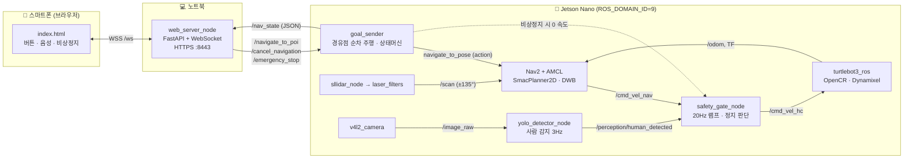

# 🦽 노약자를 위한 음성인식 자율주행 휠체어 모듈 

> **Voice-Enabled Autonomous Wheelchair Module for Elderly Users**
> 충북대학교 지능로봇공학과 캡스톤디자인 Ⅰ·Ⅱ · 2025.09 ~ 2026.06 · 지도교수 김곤우
> 2인 팀: **이승준(팀장)**, 장동완

병원에 이미 있는 **수동 휠체어 하단에 붙였다 뗄 수 있는 자율주행 구동 모듈**을 목표로, 3D 프린터로 만든 축소 플랫폼에 ROS 2 자율주행 시스템을 구현했습니다.
환자가 스마트폰 웹 페이지에서 **버튼이나 음성으로 병실을 고르면**, 휠체어가 스스로 경로를 계획해 복도 중앙으로 이동하고, 앞에 사람이 나타나면 부드럽게 멈췄다가 다시 출발하며, 병실 문 앞에서 방향을 맞춘 뒤 진입합니다.

| 항목 | 내용 |
|---|---|
| 내 역할 | **팀장** · 하드웨어 설계 · 모터 제어 · 안전 알고리즘 설계 |
| 플랫폼 | Ubuntu 22.04 · ROS 2 Humble · Python 3.10 |
| 하드웨어 | NVIDIA Jetson Nano · OpenCR 1.0 + Dynamixel (차동 구동) · RPLIDAR C1 · Innomaker USB 카메라 · 12V Li-Po |
| 핵심 기술 | Cartographer SLAM · AMCL · Nav2 (SmacPlanner2D + DWB) · YOLO (ultralytics) · FastAPI · WebSocket · Web Speech API |
| 결과 | 축소 병원 환경에서 9개 경로 자율주행, 폭 40cm 병실 문(양쪽 여유 6cm) 무접촉 진입, 비상정지 후 9개 경로 전 구간 정상 재개 |

---

## 목차
1. [개발 배경](#1-개발-배경)
2. [해결 방안과 작품의 특징](#2-해결-방안과-작품의-특징)
3. [하드웨어 구성](#3-하드웨어-구성)
4. [소프트웨어 구성](#4-소프트웨어-구성)
5. [동작 원리](#5-동작-원리)
6. [문제 해결 과정](#6-문제-해결-과정)
7. [결과와 정량 평가](#7-결과와-정량-평가)
8. [한계와 향후 계획](#8-한계와-향후-계획)
9. [실행 방법](#9-실행-방법)

---

## 1. 개발 배경

- 65세 이상 인구가 20%를 넘는 초고령사회에 다가가면서 병원 안에서 병실·검사실·물리치료실을 오가는 **원내 근거리 이동 수요**가 늘고 있지만, 이송을 맡는 인력은 그만큼 늘지 못해 야간·주말에는 이동이 미뤄지기도 합니다.
- 노인 환자의 휠체어 사용 실태 연구에서도 직접 바퀴를 굴릴 때의 관절 통증과 조작의 어려움이 주요 불만으로 나타났습니다.

| 기존 방식 | 한계 |
|---|---|
| 수동 휠체어 | 뒤에서 밀어 줄 보조 인력이 항상 필요, 경로 판단도 사람 몫 |
| 조이스틱 전동 휠체어 | 판단력이 떨어진 노약자는 오조작 위험, 장애물 앞에서 **스스로 멈추는 기능 없음** |
| 상용 실내 자율 이동체 | 대부분 화물용 물류 로봇. 사람이 타는 이동체는 안전 기준이 달라 상용화가 더딤 |

정리하면 **① 이동 판단을 여전히 사람이 하고, ② 사람을 인식해 멈추거나 원격으로 세우는 능동 안전장치가 없으며, ③ 좁은 병실 문과 복도 손잡이 같은 병원 환경이 설계에 반영되지 않았다**는 세 가지 공백이 있었습니다.

## 2. 해결 방안과 작품의 특징

| 방안 | 내용 |
|---|---|
| 탈부착형 모듈 | 휠체어를 새로 만들지 않고 기존 수동 휠체어 하단 프레임에 체결하는 구동 모듈을 지향. 실척 체결 구조는 과목 범위를 넘어 **3D 프린터 축소 플랫폼으로 개념과 자율주행 동작을 먼저 검증** |
| 실내 위치 추정 | GPS가 안 되는 실내에서 라이다 스캔을 미리 만든 지도와 맞춰 보는 AMCL |
| 경로 계획·주행 | Nav2 — 전역 경로는 SmacPlanner2D, 실시간 속도와 장애물 회피는 DWB |
| 복도 중앙 주행 | 복도 벽 손잡이를 짚고 걷는 환자와 부딪히지 않도록 복도 중앙 경유점(center1, center2)을 거쳐 이동 |
| 문 앞 기수 정렬 | 비스듬히 들어가면 문틀에 부딪히므로, 문 앞 경유점에서 다음 지점을 정면으로 바라보게 회전한 뒤 직진 진입 |
| 사람 인식 완만 정지 | 카메라 YOLO로 전방의 사람을 인식하면 급정지 대신 감속도를 제한해 부드럽게 정지(쏠림에 의한 2차 낙상 방지), 비켜나면 자동 재출발 |
| 원격 비상정지 | 스마트폰 버튼 하나로 즉시 정지. 해제하면 경로를 새로 계산하지 않고 **멈췄던 구간부터 이어서** 주행 |
| 앱 없는 음성 웹 UI | 스마트폰 브라우저에서 버튼·음성으로 목적지 지정. 브라우저 마이크는 HTTPS에서만 허용되므로 자체 서명 인증서로 HTTPS 서버 구축 |

### 작품의 특징
- **완전 자율주행**: 사용자가 하는 일은 처음에 목적지를 고르는 것 한 번뿐입니다. 경로 계산, 경유점 통과, 장애물 회피, 문 앞 정렬과 진입, 도착 판정은 휠체어가 스스로 합니다.
- **3중 능동 안전 체계**: 서로 다른 원리의 세 계층이 서로를 보완합니다.

  | 계층 | 센서 | 대상 | 동작 |
  |---|---|---|---|
  | 1 | 라이다 costmap | 지도에 없는 모든 장애물 | 경로를 다시 계획해 회피, 지나갈 수 없으면 정지 후 자동 재개 |
  | 2 | 카메라 YOLO | 전방의 사람 | 감속도 제한 완만 정지, 사라지면 자동 재출발 |
  | 3 | 웹 원격 비상정지 | 사람의 판단 | 즉시 정지, 해제 시 같은 구간부터 재개 |
- **안전 우선 아키텍처**: Nav2의 속도 명령은 모터로 바로 가지 않고 반드시 `safety_gate` 노드를 거칩니다. 바퀴로 가는 토픽을 이 노드 하나만 발행하게 해, 정지 명령이 주행 명령에 덮여 무력화되는 문제를 구조적으로 막았습니다.
- **데이터와 코드 분리**: 목적지 좌표는 YAML, 공간 정보는 지도 파일로 분리해 병원 구조가 바뀌어도 코드 수정 없이 지도와 좌표 파일만 바꾸면 됩니다.
- **정량적 진단**: "벽에 부딪힌다" 같은 현상이 아니라 위치 추정 공분산과 배터리 실측 전압을 기준으로 원인을 찾았습니다.

## 3. 하드웨어 구성

| 모듈 | 부품 | 역할 |
|---|---|---|
| 메인 컴퓨팅 | NVIDIA Jetson Nano | 위치 추정, 경로 계획, YOLO 추론, 안전 게이트 등 상위 연산 |
| 구동·하위 제어 | OpenCR 1.0 + Dynamixel | 속도 명령을 받아 바퀴 구동, 엔코더로 오도메트리 발행. 제자리 회전이 되는 차동 구동 |
| 라이다 | RPLIDAR C1 | 360° 2D 스캔 — 지도 작성, AMCL 위치 매칭, costmap 장애물 감지 |
| 카메라 | Innomaker USB 카메라 | YOLO 사람 인식용 전방 영상 |
| 전원 | 12V Li-Po | 구동부와 제어부 전원 |

**축소 플랫폼 배치**: 전면에 카메라, 상단에 라이다, 라이다 뒤에 OpenCR, 하부에 Jetson Nano를 두고, 구동 바퀴는 차체 뒤쪽 좌우에, 배터리는 두 모터 사이 중앙에 놓아 무게중심이 치우치지 않게 했습니다. OpenCR 위는 휠체어가 얹히는 적층 구조로, 실제로는 위에 기존 휠체어가 놓이고 아래에 모듈이 붙는 형태를 축소해 재현한 것입니다. 뒤쪽 제어부와 휠체어 결합부가 라이다 후방을 가리므로 **전방 약 270°만 유효 스캔 범위**로 사용합니다.

**축소 병원 환경**: 병실 3개(301·302·303호)와 중앙 복도, 경유점 2개(center1·center2)로 구성했습니다. 실제 병실 문(0.8m 이상)과 휠체어 폭(65cm)의 빠듯한 여유를 줄여, **문 폭 40cm · 차폭 28cm · 양쪽 여유 6cm**로 재현했습니다.

## 4. 소프트웨어 구성

소프트웨어는 ROS 2 노드로 기능별로 나눠, 각 모듈을 따로 개발·시험하거나 교체할 수 있게 했습니다.
**목적지 지휘(goal_sender)는 어디로 갈지, 주행 제어(Nav2)는 어떻게 갈지, 안전 게이트(safety_gate)는 그 명령을 내보내도 되는지**를 판단합니다.



### 패키지

```
hospital_robot_ws/
├── src/
│   ├── hospital_robot_bringup/      # 실행 총괄: 센서·Nav2 런치, nav2_params.yaml, RViz 설정
│   ├── hospital_robot_poi/          # 목적지 데이터: destinations.yaml, 음성 문장 파서, RViz 클릭 등록 도구
│   ├── hospital_robot_navigation/   # 판단·지휘: goal_sender (경유점 순차 주행 · 비상정지 상태머신)
│   ├── hospital_robot_perception/   # 인지·안전: yolo_detector_node, safety_gate_node
│   ├── hospital_robot_web/          # 관제·UI: HTTPS 웹 서버, 스마트폰 화면(index.html)
│   ├── hospital_robot_description/  # URDF(xacro), Gazebo 병원 복도 월드
│   ├── hospital_robot_safety/       # safety_gate 확장판 (라이다 전방 근접 정지 추가, 실험용)
│   └── hospital_robot_msgs/         # 커스텀 msg/srv 정의
├── maps/                            # SLAM으로 만든 점유격자 지도 (5cm 해상도)
├── wheelchair_teleop.py             # 키보드 원격 조종 (지도 작성·좌표 측정용)
├── drive_im.py                      # 오도메트리 기준 1m 직진 시험
└── turn_90.py                       # 지정 각도 제자리 회전 시험
```

### 주요 토픽

| 토픽 | 타입 | 발행 → 구독 |
|---|---|---|
| `/scan` | `sensor_msgs/LaserScan` | 라이다 → 각도 필터(전방 270°) → AMCL, costmap |
| `/odom` | `nav_msgs/Odometry` | OpenCR → AMCL, Nav2 |
| `/amcl_pose` | `geometry_msgs/PoseWithCovarianceStamped` | AMCL → goal_sender (위치와 공분산) |
| `/image_raw` | `sensor_msgs/Image` | 카메라 → yolo_detector_node |
| `/perception/human_detected` | `std_msgs/Bool` | yolo_detector_node → safety_gate |
| `/cmd_vel_nav` | `geometry_msgs/Twist` | Nav2(리맵) → safety_gate |
| `/cmd_vel_hc` | `geometry_msgs/Twist` | **safety_gate만 발행** → OpenCR 구동 노드 |
| `/navigate_to_poi` | `std_msgs/String` | 웹 서버 → goal_sender |
| `/emergency_stop` | `std_msgs/Bool` | 웹 서버 → goal_sender (True 정지 / False 해제) |
| `/nav_state` | `std_msgs/String` (JSON) | goal_sender → 웹 서버 (0.5초 주기) |

## 5. 동작 원리

### 5-1. 지도 작성 (SLAM)
로봇을 원격 조종하며 라이다 스캔을 쌓아 **5cm 격자의 2D 점유격자 지도**를 만들었습니다(Cartographer). 각 칸은 점유(벽)·빈 공간(통로)·미확인 세 상태를 가지며, 경로 계획의 기준이 됩니다.

### 5-2. 위치 추정 (AMCL)
파티클 필터 기반 몬테카를로 위치 추정을 **예측(오도메트리로 파티클 이동) → 보정(라이다 스캔과 지도 비교) → 재표집 → 추정(평균 위치·공분산)** 순서로 반복합니다. 파티클은 300~2000개를 유지하고, 바퀴 미끄러짐이 잦은 휠체어 특성을 반영해 회전 오차 노이즈 계수를 크게 잡았습니다.

### 5-3. 경로 계획과 주행 제어 (Nav2)
| 구분 | 설정 | 이유 |
|---|---|---|
| 전역 계획 | SmacPlanner2D, 장애물 근처 비용 15배, 5Hz | 벽에서 최대한 떨어진 최단 경로 |
| 지역 제어 | DWB, 10Hz, 직진 10 × 회전 40 = 400개 궤적 후보를 평가해 최고 점수 선택 | 실시간 장애물 회피 |
| costmap 팽창 반경 | 전역 6cm / 지역 4cm로 이원화 | 복도에서는 벽과 거리를 두고, 40cm 문은 막힌 길로 오인하지 않고 통과 |
| 속도 | 최대 직진 0.12 m/s, **후진 금지**(최소 0), 최대 회전 0.25 rad/s | 탑승자 승차감, 뒤쪽 시야 없음, 회전 시 라이다 스캔 왜곡과 조향 성능의 균형 |

### 5-4. 경유점 지휘와 문 앞 기수 정렬 (`goal_sender`)
```
301 ── center1 ── center2 ── 303
          │
         302
```
- 병원 구조를 위 경로 그래프로 정의하고, 목적지까지의 경로를 만든 뒤 **각 지점을 별도의 목표로 하나씩** Nav2에 보냅니다. 앞 지점 도착이 확인돼야 다음 구간을 보냅니다.
- 문 앞 경유점에서는 다음 지점(병실 안쪽)을 바라보는 방향을 계산해 쿼터니언으로 바꿔 보냅니다. 휠체어는 제자리 회전으로 문을 정면으로 본 뒤 직진 진입합니다.

  $$\theta_{yaw} = \operatorname{atan2}(y_{next} - y_{cur},\ x_{next} - x_{cur})$$
- 논리 위치(현재 301호)와 물리 위치(AMCL 좌표)를 함께 관리해, 주행이 실패하면 AMCL 좌표에서 가장 가까운 지점으로 논리 위치를 다시 맞추고 다음 지시를 기다립니다.
- 상태: 대기 · 주행 중 · 도착 · 취소 · 실패 · 비상정지 — 0.5초마다 JSON으로 발행

### 5-5. 비상정지 — 일시정지와 복원
비상정지는 프로세스 종료나 단순 취소가 아니라 **경로를 보존하는 일시정지**로 설계했습니다.
1. 비상정지(True) 수신 → Nav2 목표 취소 + 정지 명령 발행, 진행 중이던 **경유점 경로와 현재 구간 번호를 그대로 보관**, 해제 전까지 새 목적지 무시
2. 해제(False) 수신 → 경로를 다시 계산하지 않고 보관한 경로·구간 번호로 **같은 구간을 다시 전송**

재계산을 하면 아직 지나지 않은 문 앞 경유점을 건너뛰고 문틀로 직행할 수 있어, 이를 원천적으로 막는 구조입니다.

### 5-6. 사람 인식 (`yolo_detector_node`)
Jetson의 연산 부하를 고려해 **초당 3회, 입력 320px**로 추론합니다. 신뢰도 0.70 이상의 사람 박스에 대해 오탐을 막는 필터를 거칩니다.

| 필터 | 조건 |
|---|---|
| 형상 | 세로로 긴 사람 형태의 박스만 (가로세로 비율, 최소 크기) |
| 근접 | 박스 높이 200px 이상 — 단안 카메라라 박스 크기로 거리를 근사 |
| 전방 | 박스 중심이 화면 중앙 ±30% 안 — 옆으로 지나가는 사람에게 과잉 제동 방지 |
| 디바운스 | 위 조건이 **2프레임 연속**일 때만 사람 감지로 확정 |

### 5-7. 단일 안전 관문 (`safety_gate_node`)
Nav2 출력을 `/cmd_vel_nav`로 리맵해 게이트가 받고, **바퀴 토픽(`/cmd_vel_hc`)은 게이트만 발행**합니다. 게이트는 20Hz로 다음 규칙을 적용합니다.

| 상황 | 동작 |
|---|---|
| 사람 감지 | 목표 속도 0, 감속도 0.4 m/s² 이하로 완만 정지. 감지가 풀려도 잠시 정지를 유지해 깜빡임으로 인한 덜컹거림(채터링) 방지 |
| Nav2 명령 0.5초 이상 끊김 | 목표 속도 0 (통신 이상·노드 정지 대비) |
| 정상 | Nav2 목표 속도에 가속 0.3 / 감속 0.4 m/s² 램프 적용 |
| 게이트 종료 | 종료 직전 정지 명령 1회 발행 |

원격 비상정지는 goal_sender가 Nav2 목표를 취소하고 정지 명령을 보내, 이 게이트를 거쳐 바퀴가 멈춥니다.

### 5-8. 스마트폰 웹 관제 (`hospital_robot_web`)
- 노트북에서 **FastAPI + Uvicorn** 서버를 띄우고, 스마트폰과는 **WebSocket**으로 양방향 통신합니다. 버튼을 누르면 서버가 ROS 2 목적지 토픽으로 바꿔 발행합니다.
- 브라우저 내장 **Web Speech API**로 "301호 가줘" 같은 음성을 텍스트로 바꾸고, 파서가 "301호", "삼공일호"를 목적지 ID로 변환합니다.
- 마이크는 HTTPS에서만 켜지므로 openssl 자체 서명 인증서로 **8443 포트 HTTPS** 서버를 구동합니다.
- goal_sender의 상태 JSON을 접속한 모든 스마트폰에 브로드캐스트해, 환자와 보호자·간호사가 동시에 상태를 볼 수 있습니다.

### 5-9. 좌표 변환 트리 (TF)
`map → odom`(AMCL) · `odom → base_link`(OpenCR, 약 30Hz) · `base_link → 라이다/카메라`(정적 변환)로 이어집니다. 이 사슬이 끊기거나 지연되면 Nav2가 연산을 멈추므로, 모터 노드가 죽으면 위치 추정과 주행이 함께 멈춰 로봇이 무방비로 달리는 것을 막습니다.

## 6. 문제 해결 과정

| 분류 | 문제 | 원인 | 해결 |
|---|---|---|---|
| 전원 | OpenCR 경고음 후 꺼짐, TF 10초 이상 지연, AMCL 위치가 수 m 튐, 웹 화면 멈춤이 동시에 발생 | 충전기는 완충 표시였지만 실측 전압이 **11.4V**(정상 12.6V). 저전압으로 OpenCR이 꺼지면서 오도메트리·TF가 끊겨 위치 추정·주행이 연쇄 마비 | 개발 중 유선 전원 사용, 시험 전 전압 측정을 표준 절차로 명문화 |
| 장치 | 런치 시 `DynamixelSDKWrapper initialization failed` | 부팅마다 라이다와 OpenCR의 USB 포트 번호가 뒤바뀌어 보드레이트 불일치 | Vendor/Product ID 기반 udev 규칙으로 장치 이름 고정 |
| 위치 추정 | 목적지 좌표 갱신 후 경로 이탈, 301호 진입 중 303호로 인식, 남은 거리가 0~1.4m 사이를 오감 | 로봇을 **손으로 옮겨** 좌표를 쟀더니 오도메트리는 0인데 라이다는 이동을 감지 → 파티클 필터가 수렴하지 못함. 공분산 0.179~0.222(오차 약 42cm 이상) | 공분산을 진단 지표로 도입. **원격 주행 → 2~3초 정지 → 공분산 0.01 이하 확인 후 좌표 채택** 절차 확립 → 공분산 0.00009~0.006(오차 1~7cm) |
| 지도 | 병실 회전 공간을 넓히려 지도를 다시 만들자 로봇이 자신을 다른 방에 있다고 인식, 경로 생성 실패 | 새 지도로 좌표계 원점이 바뀌었는데 초기 자세와 목적지 좌표는 옛 기준 | 새 지도 기준으로 초기 자세·목적지 좌표 재측정, 지도 작성 시 운용 영역 주변 여백 확보를 지침에 추가 |
| 위치 추정 | 제자리 회전 중 위치 추정 발산 | 회전 중 스캔 왜곡 + 특징 없는 직사각형 병실 + 과민한 매칭 설정이 겹침 | 방마다 다른 특징물을 놓고 지도 재작성, 회전 중 갱신 빈도 상향, 회전 속도 0.15·0.20·0.25 rad/s 비교 → 0.15는 조향 불능, **0.25 채택** |
| 제어 | 비상정지 해제 후 문틀로 돌진 | 해제 시 경로를 다시 계산하면서 문 앞 경유점을 건너뜀 | 경유점 그래프 + 다익스트라 재경로 방식도 구현했으나, 위치 오차가 남은 상태에서 진입점을 잘못 골라 역주행하는 문제 확인 → **경로와 구간 번호를 보관했다가 그대로 복원**하는 방식으로 확정 |
| 제어 | 비상정지 버튼을 눌러도 계속 전진 | 정지 명령과 주행 명령이 같은 토픽에 발행돼, 0 속도가 0.05초 만에 다음 주행 명령에 덮어씌워짐 | 바퀴 토픽 발행 주체를 `safety_gate` 하나로 통일하고 Nav2 출력을 리맵 |
| 제어 | 경유지를 지나며 통로 벽에 걸림 | 경유점은 근처만 지나도 통과로 처리돼 계획 경로와 실제 주행이 어긋남 | 각 지점을 독립된 목표로 보내고 도착 확인 후 다음 구간 계획 |
| 딥러닝 | YOLO 설치 후 `cv_bridge` 등 ROS 라이브러리가 런타임에 크래시 | ultralytics가 NumPy를 2.x로 올림 (ROS 2 Humble은 1.x 기준 빌드) | NumPy 1.24.4로 고정. CUDA 버전 불일치로 GPU를 못 쓰지만 320px·3Hz 설계 덕분에 CPU만으로 실시간 동작 |
| 통신 | 웹 버튼을 눌러도 로봇이 반응 없음 | 노트북 터미널의 `ROS_DOMAIN_ID`가 기본값 0 (Jetson은 9) | 모든 터미널 9로 통일, 실행 절차에 명시 |
| 통신 | 스마트폰에서 음성 인식 불가 | 브라우저가 HTTP 접속에서 마이크 권한 차단 | openssl 자체 서명 인증서로 HTTPS(8443) 구동 |

<details>
<summary><b>검토했지만 채택하지 않은 대안</b></summary>

| 대안 | 판단 |
|---|---|
| 경유점마다 멈춰 위치를 다시 수렴시키기 | 매번 멈칫거려 탑승 품질이 떨어져 기각 → 주행 중 갱신 빈도를 높이는 쪽으로 해결 |
| IMU 융합 EKF | 회전 중 오도메트리 개선에 필요하지만 TF 구조 전체를 바꿔야 해 회귀 위험이 큼 → 단기 과제로 보류 |
| 카메라 광학 흐름으로 움직이는 사람 구분 | 휠체어가 움직이면 배경 전체가 흘러(자기 운동) 오탐 급증 → 기각, "사람이면 일단 정지"로 단순화 |
| 도착 방향 허용 오차 완화 | 병실 안 회전 충돌을 피할 수 있지만 나올 때 어차피 회전해야 해 문제를 미루는 것에 불과 → 기각 |
</details>

## 7. 결과와 정량 평가

- **전체 서비스 흐름 시연**: 음성으로 301호 지시 → 복도 중앙 경유점 주행 → 문 앞 기수 정렬 후 진입 / 이동 중 보행자 등장 시 완만 정지 후 자동 재출발 / 원격 비상정지 후 해제 시 같은 구간부터 재개 / 도착 후 상태 "도착 완료" 갱신
- **경로**: 병실 3개와 경유점 2개를 조합한 **9개 경로** 자율주행, 폭 40cm 문(양쪽 여유 6cm) 무접촉 통과
- **위치 추정**: 측정 절차 적용 후 공분산 0.18~0.22 → **0.00009~0.006** (위치 오차 약 1~7cm, 신뢰도 30배 이상 향상)
- **비상정지 복원**: 9개 경로 전 구간에서 오작동·목적지 오판 없이 **100% 같은 구간 재개**
- **임베디드 추론**: GPU 없이 CPU만으로 사람 인식 기반 완만 정지 유지, 2프레임 디바운스와 중앙 밴드 필터로 오탐 억제

## 8. 한계와 향후 계획

| 구분 | 한계 | 계획 |
|---|---|---|
| 단기 | 제자리 회전 시 위치 오차 누적을 완전히 없애지 못함 | 지도 특징물 밀도 향상, IMU 융합 EKF, 라이다 스캔 왜곡 보상 |
| 중기 | 카메라가 사람이 움직이는지 서 있는지 구분 못 함 / 단안 카메라라 실제 거리 대신 박스 크기로 근사 | 라이다 클러스터 추적으로 동적·정적 장애물 구분, 카메라·라이다 정합으로 실제 거리 측정 |
| 장기 | 1/10 축소 모형이라 성인 탑승 시의 하중·관성 미반영 | 실척 휠체어로 확장해 가감속 파라미터·기구 재설계, 병원 정보 시스템(HIS·EMR)과 연동한 다중 휠체어 배차·관제 |

## 9. 실행 방법

<details>
<summary><b>준비 · 빌드</b></summary>

```bash
# ROS 2 Humble 패키지
sudo apt install ros-humble-navigation2 ros-humble-nav2-bringup ros-humble-slam-toolbox \
                 ros-humble-v4l2-camera ros-humble-laser-filters ros-humble-turtlebot3-bringup

# 라이다 드라이버(sllidar_ros2)는 src/에 별도로 클론
cd ~/hospital_robot_ws/src && git clone https://github.com/Slamtec/sllidar_ros2.git

# Python 패키지 — NumPy 2.x가 깔리면 cv_bridge가 깨지므로 1.x로 고정
pip install ultralytics fastapi uvicorn pyyaml "numpy<2"

# 빌드 (작업공간 경로는 ~/hospital_robot_ws 기준. 일부 코드가 이 경로를 기본값으로 씀)
cd ~/hospital_robot_ws && colcon build --symlink-install
source install/setup.bash
```

- 장치 이름: 라이다 `/dev/rplidar`(460800bps), OpenCR `/dev/ttyOpenCR`(환경변수 `OPENCR_PORT`로 변경 가능), 카메라 `/dev/video0`. udev 규칙으로 이름을 고정해 사용했습니다.
- YOLO 가중치(`best.pt`)는 저장소에 없습니다. [`perception.launch.py`](src/hospital_robot_perception/launch/perception.launch.py)의 `model_path`를 실제 경로로 바꾸세요.
- 모든 터미널에서 `export ROS_DOMAIN_ID=9`
</details>

<details>
<summary><b>실제 로봇 주행</b></summary>

```bash
# [Jetson] 1. 센서 + 구동부 (라이다, 각도 필터, 카메라, OpenCR)
ros2 launch hospital_robot_bringup view_sensors.launch.py
# [Jetson] 2. 지도 + AMCL + Nav2  (기본 지도: ~/hospital_robot_ws/maps/hospital_map.yaml)
ros2 launch hospital_robot_bringup navigation.launch.py
# [Jetson] 3. 사람 감지 + 안전 게이트
ros2 launch hospital_robot_perception perception.launch.py
# [Jetson] 4. 목적지 지휘 노드
ros2 run hospital_robot_navigation goal_sender

# [노트북] 5. 웹 서버 → 스마트폰에서 https://<노트북 IP>:8443 접속
ros2 launch hospital_robot_web web.launch.py
```

명령줄로 시험:
```bash
ros2 topic pub --once /navigate_to_poi std_msgs/String "data: '301'"
ros2 topic pub --once /emergency_stop std_msgs/Bool "data: true"    # 비상정지
ros2 topic pub --once /emergency_stop std_msgs/Bool "data: false"   # 해제 → 같은 구간부터 재개
```
</details>

<details>
<summary><b>HTTPS 인증서 · 웹 UI만 시험 · 목적지 등록</b></summary>

```bash
# 인증서가 있으면 8443(HTTPS), 없으면 8000(HTTP)으로 실행됨
mkdir -p ~/hospital_robot_ws/certs && cd ~/hospital_robot_ws/certs
openssl req -x509 -newkey rsa:2048 -nodes -keyout key.pem -out cert.pem -days 365 -subj "/CN=hospital-robot"

# 로봇 없이 웹 UI만 시험 (가짜 주행 상태 발행)
ros2 run hospital_robot_web fake_goal_sender
ros2 launch hospital_robot_web web.launch.py

# 목적지 등록: RViz 상단 "Publish Point"로 지도 클릭 → destinations.yaml에서 id/name 수정
ros2 launch hospital_robot_bringup poi_register.launch.py
```
좌표는 손으로 옮기지 말고 **원격 조종으로 이동 → 2~3초 정지 → 공분산 0.01 이하 확인** 후 기록합니다.
</details>

---

### 관련 저장소
- [ros2_ws](https://github.com/bananabus6907/ros2_ws) — TurtleBot3 + Jetson Nano 카메라 라인트레이싱 (로봇프로그래밍)
- [ros2-rover-simulation](https://github.com/bananabus6907/ros2-rover-simulation) — URDF/Xacro 로버 Gazebo 시뮬레이션
